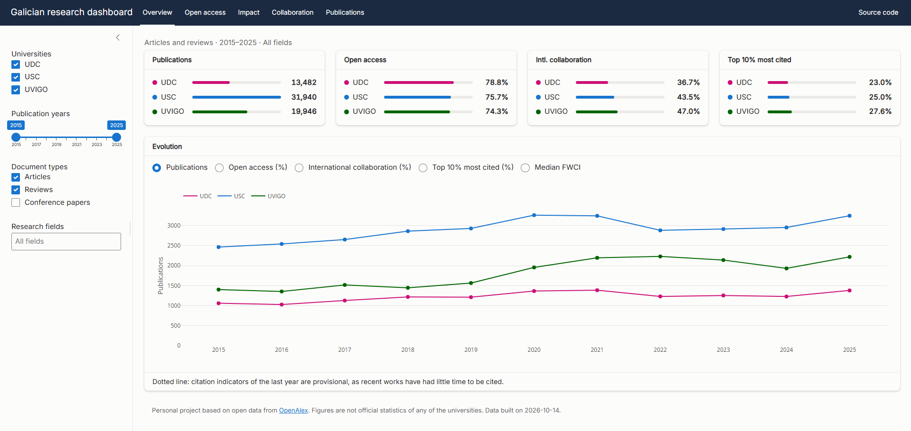
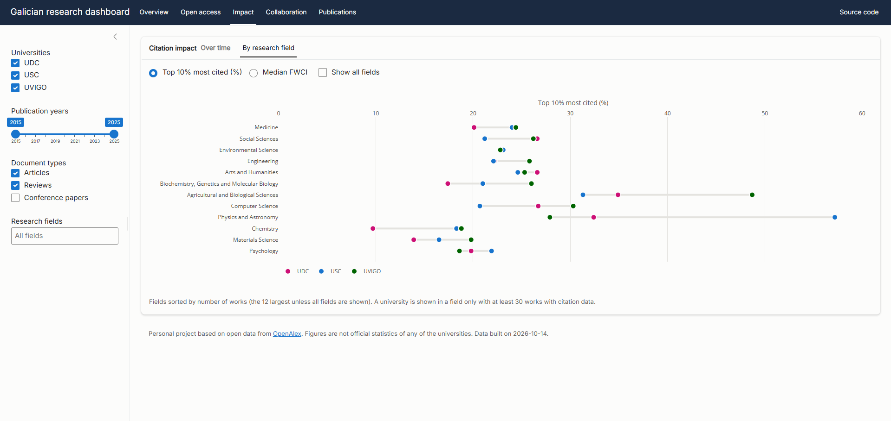
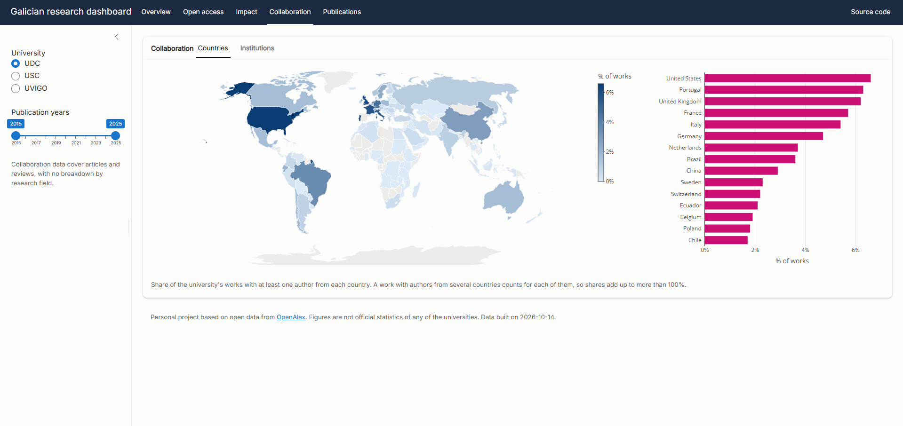
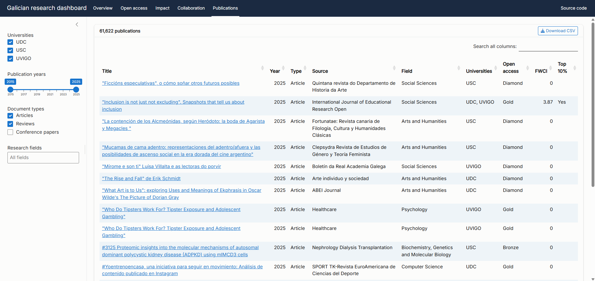

# Galician research dashboard

Interactive dashboard on the research output, open access, citation impact and collaboration of the three public universities of Galicia (Spain): Universidade da Coruña (UDC), Universidade de Santiago de Compostela (USC) and Universidade de Vigo (UVIGO), 2015–2025.

**[Open the live app](https://borjalafuente.shinyapps.io/galician-research-dashboard/)** · Built with R Shiny on open data from [OpenAlex](https://openalex.org).

> Personal project based on open data. Figures are not official statistics of any of the universities.



## What it shows

Every chart responds to the filters in the sidebar: universities, publication years, document types and research fields.

| Tab | Content |
|---|---|
| **Overview** | Summary cards for the selected period and the evolution of the main indicators. |
| **Open access** | Open access routes (gold, diamond, hybrid, bronze, green, closed) over time and for the whole period. |
| **Impact** | Share of works in the 10% and 1% most cited and median FWCI over time, and by research field. |
| **Collaboration** | World map of partner countries and map and ranking of partner institutions, one university at a time. |
| **Publications** | The works behind every indicator: searchable, with links to each publication and CSV download. |

<details>
<summary><b>More screenshots</b></summary>





</details>

## Data and method

The data come from the companion repository [openalex-galician-universities](https://github.com/BorjaLafuente/openalex-galician-universities), a Python and SQL pipeline that downloads the works of the three universities from the OpenAlex API, cleans them and stores them in SQLite. The method, data quality checks and validation against the CWTS Leiden Ranking are documented there, in [`docs/findings.md`](https://github.com/BorjaLafuente/openalex-galician-universities/blob/main/docs/findings.md).

- **Counting**: full counting. A work shared by two universities counts for both.
- **Citation indicators**: OpenAlex's FWCI and top 10% / top 1% flags. They are about twice as high as those of the Leiden Ranking, so they are meant for comparing the three universities, not as absolute levels. The last year is shown as provisional.
- **Collaboration**: co-author countries and institutions are counted by OpenAlex (`group_by`) for articles and reviews. Grouping institutions by their hierarchy inflates the counts of parent bodies such as ministries, funders or regional health services; for institutions with less than 10% of direct affiliations, the direct count is used instead.

### Checked against the SQL indicators

`scripts/check_indicators.R` recomputes the indicators with the app's R functions and compares them with the results of the SQL queries in the OpenAlex repository. Two independent implementations, same data: every indicator matches exactly for all 33 university–year pairs.

## How it is built

```
openalex-galician-universities          (Python + SQL)
  OpenAlex API -> ... -> data/openalex.db
                              |
galician-research-dashboard             (R)
  scripts/build_app_data.R -> data/app.sqlite  (only what the app needs)
  app.R + R/                -> Shiny app
```

```
app.R                 page layout, sidebar filters, one call per tab
R/data.R              reads app.sqlite and computes the indicators (no Shiny code)
R/plots.R             chart functions (plotly)
R/theme.R             colours, labels and settings
R/mod_*.R             one Shiny module per tab
www/styles.css        styles
scripts/              data build and checks, not part of the deployed app
data/app.sqlite       app data (28 MB)
```

Some design choices:

- **Data, charts and interface are kept apart.** `R/data.R` and `R/plots.R` know nothing about Shiny, so the indicators can be tested on their own, as `check_indicators.R` does.
- **One Shiny module per tab**, each in its own file, so a tab can be changed without touching the others.
- **A single filtered dataset** is created in `app.R` and passed to every module, so the filtering logic exists in one place only.
- **Fast filters**: the data are read once when the app starts, and the publications table is prepared once too. Moving a filter only selects rows.
- **Fixed colours per university** (the corporate colours, checked for colour-blind safety), so a university keeps its colour whatever the filters.

## Run it locally

Requires R 4.3 or later.

```r
install.packages(c("shiny", "bslib", "dplyr", "tidyr", "plotly", "DT",
                   "DBI", "RSQLite"))
shiny::runApp()
```

`data/app.sqlite` is included, so the app runs without the OpenAlex pipeline. To rebuild it from a fresh run of the pipeline, clone both repositories in the same folder and run `Rscript scripts/build_app_data.R` (it also needs `dbplyr` and `countrycode`).

## Tech stack

R · Shiny (modules) · bslib · plotly · DT · dplyr / dbplyr · SQLite (DBI, RSQLite) · shinyapps.io

## License

Code released under the [MIT License](LICENSE). Data from OpenAlex is available under CC0.

## Author

Borja Lafuente Rego — [LinkedIn](https://www.linkedin.com/in/borjalafuenterego/)
